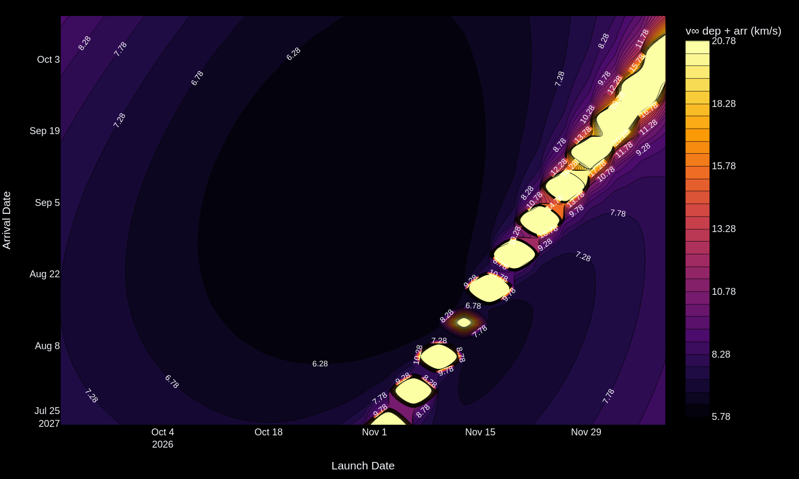

# Interplanetary Trajectory Planner


[](LICENSE)

An interactive Streamlit app for interplanetary transfer design: pick two planets, a launch date and a
time of flight, and it solves Lambert's problem between the planets' real ephemeris states, draws the
transfer in 3D, reports the hyperbolic excess speeds and the patched-conic burns, and maps the launch
window as a porkchop plot.

**Bishwaswarup Nayak** · Indian Institute of Science, Bengaluru


---

## Example: Earth → Mars, 2026 window

The app's default case, launching 30 Oct 2026 and arriving 1 Sep 2027 (306 days), sits near the
cheapest point of the 2026 window:

| | |
|---|---|
| Departure v∞ | 3.14 km/s (C3 = 9.9 km²/s²) |
| Arrival v∞ | 2.65 km/s |
| Departure burn from a 200 km circular Earth orbit | 3.66 km/s |
| Capture burn into a 200 km circular Mars orbit | 2.10 km/s |



*Sum of departure and arrival v∞ over ±40 days around the default dates. The broad dark basin is the
launch window; the diagonal ridge of bright blobs is where the transfer angle passes 180° and the
single-revolution Lambert transfer plane becomes ill-defined, so the required out-of-plane velocity
blows up. It separates the shorter (type I) and longer (type II) transfers.*

---

## How it works

1. **Ephemerides.** Planet positions and velocities at departure and arrival come from Astropy's
   built-in ephemeris through poliastro, as heliocentric orbits.
2. **Lambert's problem.** Given the two positions and the time of flight, poliastro's Lambert solver
   (`Maneuver.lambert`) returns the transfer orbit and the velocities at both ends.
3. **Hyperbolic excess speed.** v∞ is the difference between the Lambert velocity and the planet's own
   heliocentric velocity, at departure and at arrival. C3 = v∞² at departure is what a launch vehicle
   must supply.
4. **Burns (patched conic).** From a circular parking orbit of radius r about a planet with
   gravitational parameter μ, the burn onto (or off) the hyperbola is

   $$\Delta v = \sqrt{v_\infty^2 + \frac{2\mu}{r}} - \sqrt{\frac{\mu}{r}}$$

   applied at departure and, for capture, at arrival. The parking altitude is set in the sidebar.
5. **Porkchop plot.** A 25 × 25 grid of launch and arrival dates (625 Lambert solutions), coloured by
   the v∞ sum.

---

## Run

poliastro 0.17 is the last release and supports Python 3.8–3.10 only, so create the environment with
one of those versions:

```bash
git clone https://github.com/Bishwaswarup/orbital-transfer-app.git
cd orbital-transfer-app
python3.10 -m venv .venv && source .venv/bin/activate
pip install -r requirements.txt
streamlit run app.py
```

To regenerate the rotating GIF (needs `kaleido==0.2.1` and `imageio`):

```bash
pip install kaleido==0.2.1 imageio
PYTHONPATH=. python gif.py
```

## Project structure

```
app.py               Streamlit app: inputs, 3D view, porkchop tab, v∞ and Δv readouts
src/ephemeris.py     planet ephemerides → heliocentric orbits
src/trajectory.py    Lambert transfer, v∞, parking-orbit burns
src/porkchop.py      launch/arrival grid and contour plot
src/visualization.py 3D plot of the planets' orbits and the transfer
gif.py               renders assets/screenshots/trajectory_demo.gif
```

## Limitations

- Two-body, single-revolution Lambert arcs; no multi-revolution solutions, gravity assists or
  N-body propagation.
- Burns are impulsive and computed at periapsis of a circular parking orbit; launch-site latitude,
  plane changes and finite burns are ignored.
- poliastro is no longer maintained; a port to a maintained library (e.g. `lamberthub` + `astropy`)
  would lift the Python 3.10 limit.

## License

MIT, see [LICENSE](LICENSE).
