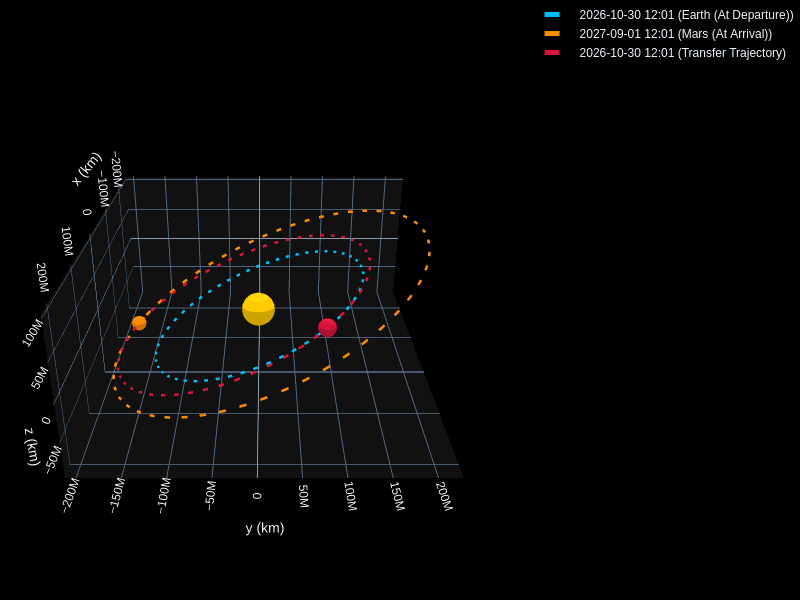

# Interplanetary Trajectory Planner 

**[ Live Demo ]** · **[ Documentation ]** · **[ Source Code ]**

> **An interactive astrodynamics application for designing, analyzing, and visualizing interplanetary transfer trajectories using Lambert's problem.**



---

## Overview

The Interplanetary Trajectory Planner is a Python-based web application that combines orbital mechanics, numerical methods, astronomical ephemerides, and interactive 3D visualization into a single mission-design interface.

Given a departure date, destination, and time of flight, the application determines the corresponding planetary states, solves Lambert's boundary-value problem, and visualizes the resulting heliocentric transfer trajectory along with the planetary orbits.

The project is designed to bridge the gap between theoretical astrodynamics and practical computational mission analysis.

---

## Key Capabilities

### Interplanetary Transfer Design

Compute heliocentric transfer trajectories between planets using their positions at user-defined departure and arrival epochs.

### Lambert's Problem

Solve the classical Lambert boundary-value problem to determine the orbit connecting two position vectors over a specified time of flight.

### Ephemeris-Based Planetary States

Retrieve time-dependent planetary positions and velocities using astronomical ephemerides, allowing the trajectory to respond dynamically to the selected mission dates.

### Interactive 3D Visualization

Explore the resulting trajectory through an interactive three-dimensional representation of the Solar System, including:

* Planetary orbits
* Planet positions
* Departure and arrival locations
* Transfer trajectory
* Direction of travel

### Mission Δv Analysis

Calculate the velocity changes required to depart from the origin planet and arrive at the destination.

The model compares the Lambert departure and arrival velocities against the planets' heliocentric velocities and uses a patched-conic approximation to estimate the required hyperbolic excess velocity ($v_{\infty}$) and mission energy requirements.

---

## Astrodynamics

The trajectory computation is based on **Lambert's problem**:

> Given two position vectors and the time of flight between them, determine the Keplerian orbit that connects the two points.

For a departure position $\mathbf{r}_1$, arrival position $\mathbf{r}_2$, and time of flight $\Delta t$, the Lambert solver determines the corresponding velocity vectors:

$$
(\mathbf{r}_1,\mathbf{r}_2,\Delta t)
\longrightarrow
(\mathbf{v}_1,\mathbf{v}_2)
$$

These velocities are then compared with the planets' heliocentric velocities to determine the required **hyperbolic excess velocity ($v_{\infty}$)** for departure and arrival.

### Vis-Viva Equation

The orbital velocity along the resulting trajectory is evaluated using the **vis-viva equation**:

$$
v = \sqrt{\mu\left(\frac{2}{r}-\frac{1}{a}\right)}
$$

where:

* $\mu$ — gravitational parameter of the central body
* $r$ — instantaneous orbital radius
* $a$ — semi-major axis of the transfer orbit

The resulting state vectors are used to characterize the transfer orbit and calculate the associated **Δv requirements**.

---

## Computational Workflow

```text
                    Mission Parameters
                           │
                           ▼
                 Departure / Arrival Dates
                           │
                           ▼
                  Planetary Ephemerides
                           │
                           ▼
                 Position & Velocity States
                           │
                           ▼
                Lambert Boundary-Value Solver
                           │
                           ▼
                     Transfer Orbit
                           │
                  ┌────────┴────────┐
                  ▼                 ▼
             Δv Analysis      3D Visualization
                                    │
                                    ▼
                          Interactive Mission View
```

---

## Technology Stack

| Component                    | Technology                           |
| :--------------------------- | :----------------------------------- |
| **Language**                 | Python                               |
| **Application Framework**    | Streamlit                            |
| **Astrodynamics Engine**     | poliastro                            |
| **Astronomical Computation** | Astropy                              |
| **Numerical Analysis**       | NumPy                                |
| **3D Visualization**         | Plotly                               |
| **Ephemerides**              | Astropy / JPL-compatible ephemerides |

---

## Example Mission

A typical analysis can be configured as an **Earth → Mars** transfer.

The application determines:

* Planetary positions at the selected epochs
* Heliocentric departure and arrival states
* Lambert transfer orbit
* Departure and arrival velocities
* Calculated **Δv requirements** using a patched-conic approximation
* Hyperbolic excess velocity ($v_{\infty}$)
* Transfer trajectory in 3D

This makes it possible to experiment with how **launch date and time of flight influence the resulting trajectory and mission energetics**.

---

## Why This Project?

Interplanetary trajectory design is a classic astrodynamics problem that combines:

**Physics + Mathematics + Numerical Methods + Software Engineering**

Rather than implementing the mathematics as a standalone calculation, this project turns the underlying orbital mechanics into an **interactive mission-analysis tool**.

It provides a computational environment for experimenting with fundamental concepts such as:

* Keplerian orbits
* Lambert's problem
* Orbital energy
* Heliocentric reference frames
* Planetary ephemerides
* Time-of-flight analysis
* Hyperbolic excess velocity
* Δv requirements
* Numerical trajectory propagation

---

## Running Locally

### 1. Clone the Repository

```bash
git clone https://github.com/yourusername/orbital-transfer-app.git
cd orbital-transfer-app
```

### 2. Install Dependencies

```bash
pip install -r requirements.txt
```

### 3. Launch the Application

```bash
streamlit run app.py
```

The application will then be available through the local Streamlit server.

---

## Project Structure

```text
orbital-transfer-app/
│
├── app.py                  # Streamlit application
├── requirements.txt        # Python dependencies
├── README.md               # Project documentation
│
├── src/
│   ├── trajectory.py       # Lambert / trajectory calculations
│   ├── ephemeris.py        # Planetary state calculations
│   └── visualization.py    # 3D trajectory visualization
│
└── assets/
    └── screenshots/
        └── trajectory-demo.gif
```

---

## Future Development

Potential extensions include:

* [x] Porkchop plots for launch-window analysis
* [ ] Multi-revolution Lambert solutions
* [x] Multiple planetary departure and arrival options
* [ ] Hohmann transfer comparison
* [ ] Planetary sphere-of-influence modeling
* [ ] Launch-window optimization
* [ ] Propellant / mass-budget estimation
* [ ] Mission trajectory export
* [ ] High-fidelity N-body propagation
* [ ] Automated trajectory optimization

---

## Engineering Scope

This application is intended primarily as an **educational and preliminary mission-design tool**.

The computed trajectories use simplified **two-body orbital mechanics** and should not be interpreted as flight-certified mission solutions.

For high-fidelity mission analysis, additional effects such as **N-body perturbations, non-spherical gravity, atmospheric drag, finite-duration burns, spacecraft mass variation, and maneuver constraints** would need to be incorporated.

---

## Project Focus

**Astrodynamics · Orbital Mechanics · Computational Physics · Numerical Methods · Scientific Python · Data Visualization · Aerospace Engineering**

---

## License

This project is intended for educational, research, and portfolio purposes.

See the repository's `LICENSE` file for licensing information.
